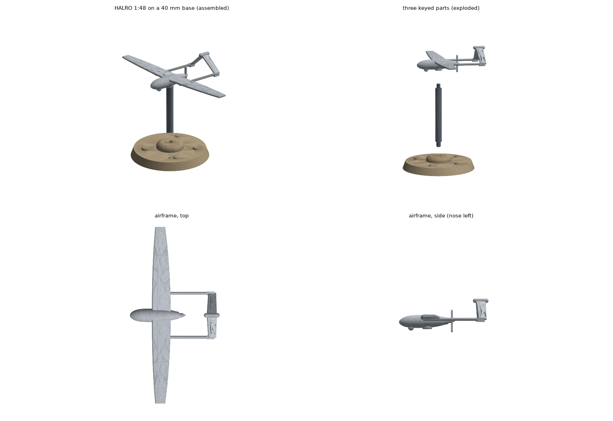

# HALRO 2.3 display miniature, 1:48, three keyed resin parts

A first real miniature made with the unified-CAD-MCP `miniature_*` tools and FreeCAD: the HALRO twin-boom pusher
(3.6 m span) at 1:48 (75 mm span) flying on a 3.5 mm stand over a 40 mm round base with a 5 x 2 mm magnet.

| File | What it is |
|---|---|
| `spec.json` | Published top-level numbers (real mm), the heroic thickening and the kit joints |
| `build.py` | FreeCAD 1.x generator: `freecad-python build.py` writes `stl/*.stl` (+ units sidecars) and `reports/build.json` |
| `check.py` | Runs the kit through `miniature_scale_convert`, `miniature_base_and_peg`, `miniature_support_plan` and `miniature_printability_check` (in-process MCP client); writes `reports/report.md` and `reports/printability.json` |
| `render.py` | Any Python with matplotlib: `preview.png` from the STLs |
| `stl/` | `halro-1-48-airframe.stl`, `-stand.stl`, `-base.stl` (print these) and `assembly.stl` (preview only) |

## The kit

- **Airframe** (0.98 g resin): pod, wing, booms, inverted-V tail, two-blade pusher and a belly ball in one piece. A 4 mm
  mount pad under the belly carries a D-flat socket (2.2 mm, 2.7 mm deep) for the stand.
- **Stand** (0.34 g): 3.5 mm rod, 30 mm tall, with a 2.0 mm D-peg up and a 2.4 mm D-peg down; the rod is wider than both
  pegs, so each joint seats on a shoulder and goes together one way only.
- **Base** (5.5 g): 40 mm round, 4 mm bevelled, river stones and a 7 mm mound with the 2.6 mm D-socket; underneath a
  5.2 x 2.1 mm magnet pocket (glue fit) with a vent groove to the rim.

Joint sizes come from `miniature_base_and_peg` (resin, glue fit, 0.1 mm per side); `check.py` asks the tool again and
fails if the spec drifts. Print a tolerance coupon on your printer and resin before trusting 0.1 mm.

## What the tools changed

1. `miniature_scale_convert` at 1:48: wing tip 0.50 mm, tail 0.42 mm, prop blades 0.25 mm and the 22.7 mm long 0.46 mm
   booms are below the MSLA limits (0.6 mm unsupported wall; Formlabs wire table). Planform and span stay true to scale;
   thickness is heroic: wing 1.0 to 0.8 mm with a 0.6 mm blunt trailing edge, tail 0.8 mm, booms 1.2 mm, blades 0.7 mm.
2. First `miniature_printability_check` on the airframe failed: 0.58 mm2 of wall under 0.4 mm between the stand socket
   and the belly, which curves up fast at this size. Fix: the mount pad (0.9 mm wall around the socket).
3. The base printed flat on the plate makes its magnet pocket a suction cup (sealed by the plate below and the film
   above); the 1.0 x 0.6 mm vent groove to the rim lets resin in and out. Largest remaining cup: the 2.6 mm stand socket
   (4.6 mm2, under the 10 mm2 default limit).
4. `miniature_support_plan` cut the airframe's largest layer from 394 mm2 (flat) to 104 mm2 by printing it rotated
   -45 deg about x; the airframe passes on supports in that pose.

Final result (`reports/report.md`): every fail-severity check passes for every part. Islands (5 on the airframe) need
supports, as expected for resin.

## Rebuild

~~~sh
/mnt/d/ai-stack/bin/freecad-python build.py          # any FreeCAD 1.x Python
python check.py                                     # a Python with unified-cad-mcp installed
python render.py                                    # a Python with matplotlib
~~~

Display model only: the subject is a civilian mapping UAS concept. Only top-level published numbers are used; the belly
ball is stylised. Heuristic printability screen, not a slicer: check supports and suction in Lychee, CHITUBOX or
PrusaSlicer and print a test piece.
